<div align="center">


<br>

[](https://nodejs.org)
[](https://expressjs.com)
[](https://mariadb.org)
[](compose.yml)
[](public/manifest.webmanifest)
[](backend/services/mcpServer.js)

**[eniv.fr](https://eniv.fr)** · [Fonctionnalités](#-fonctionnalités) · [Aperçu](#-aperçu) · [Architecture](#-architecture) · [Installation](#-installation) · [Déploiement](#-déploiement) · [Contributeurs](#-contributeurs) · [Contribuer](#-contribuer)

</div>

---

**Eniv** est un ENT léger centré sur l'essentiel : **le cahier de textes de la classe**.
Les élèves ajoutent les devoirs, tout le monde les voit **en temps réel**, chacun coche ce qu'il a fini,
et l'appli s'installe sur le téléphone comme une application native.

## ✨ Fonctionnalités

<table>
<tr>
<td width="50%" valign="top">

### 📚 Pour les élèves
- **Calendrier** mensuel sur ordinateur, **semaine par semaine** sur mobile
- Devoirs **partagés** avec toute la classe, mis en forme en **Markdown**
- **« Fait »** coché individuellement, devoirs barrés
- **Documents joints** (PDF, Word, PowerPoint, Excel), convertis en PDF pour la lecture
- **Quiz de révision générés par IA** à partir des documents (classes premium)
- **Partage** d'un devoir par lien direct

</td>
<td width="50%" valign="top">

### 🧑‍🏫 Pour les administrateurs de classe
- Gestion des **élèves**, des **matières** (couleur, lien) et des **admins**
- **Invitations par e-mail** et **lien d'inscription** à partager
- **Demandes d'adhésion** à valider
- **Historique complet** : qui a créé, modifié ou supprimé quoi
- Lien vers l'**emploi du temps**
- **Récapitulatif Discord** chaque soir et chaque samedi

</td>
</tr>
<tr>
<td valign="top">

### ⚡ Expérience
- **Temps réel** (WebSocket) : un devoir ajouté apparaît partout sans recharger
- **Application installable** (PWA) et **consultable hors ligne**
- **Thème sombre**
- Inscription libre avec **recherche de l'établissement**

</td>
<td valign="top">

### 🤖 Assistants IA (MCP)
Connectez **Claude, ChatGPT** ou tout client compatible MCP à vos devoirs avec un lien personnel (révocable, avec expiration facultative).
Outils exposés : `lister_devoirs`, `voir_devoir`, `lire_document`, `marquer_fait`, `creer_devoir`, `modifier_devoir`, `supprimer_devoir`, `lister_matieres`.

</td>
</tr>
</table>

## 📸 Aperçu

<table>
<tr>
<td colspan="2">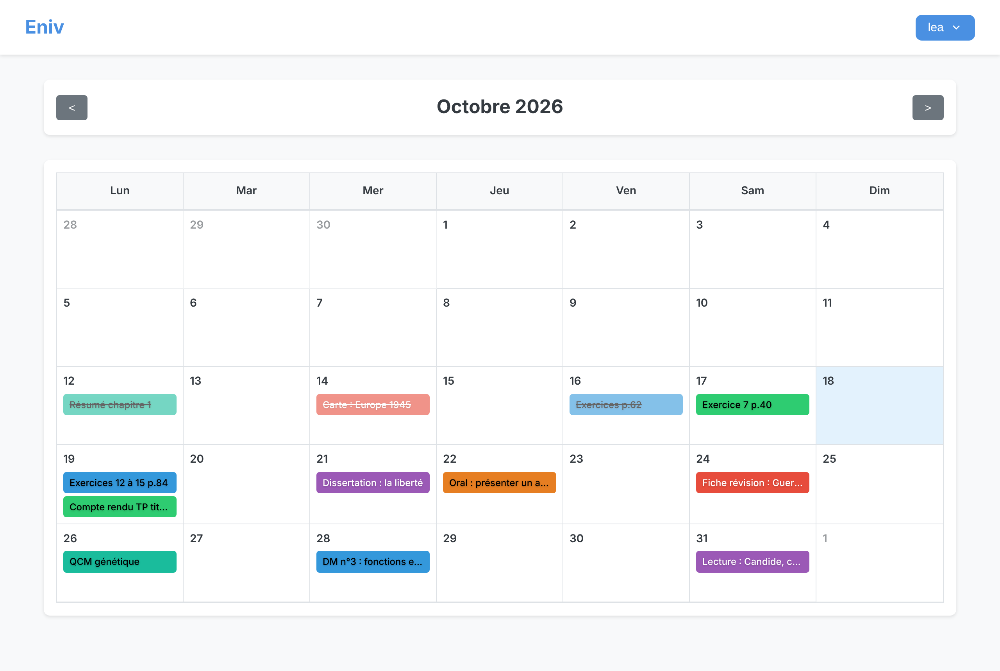</td>
</tr>
<tr>
<td width="50%">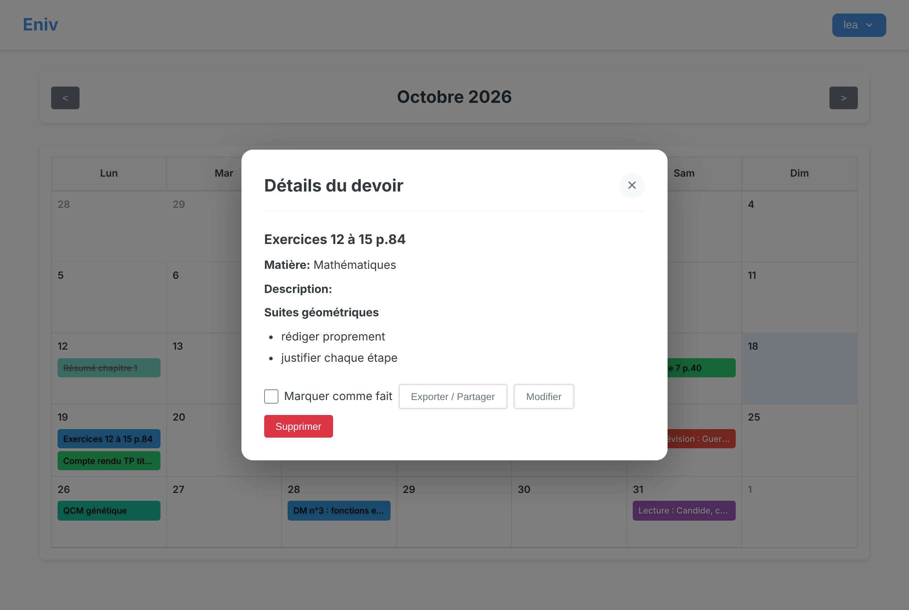</td>
<td width="50%">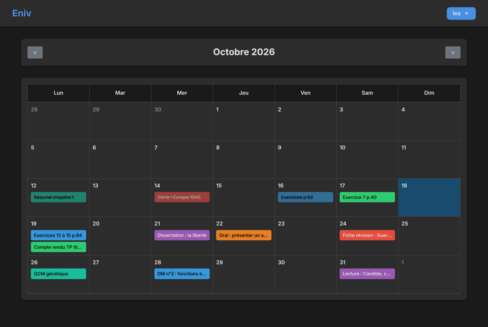</td>
</tr>
<tr>
<td align="center" width="50%">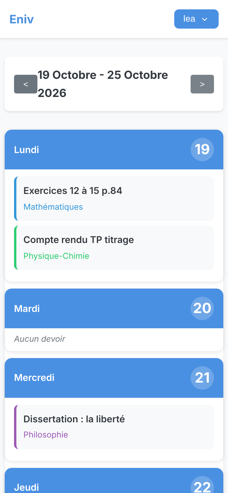</td>
<td width="50%">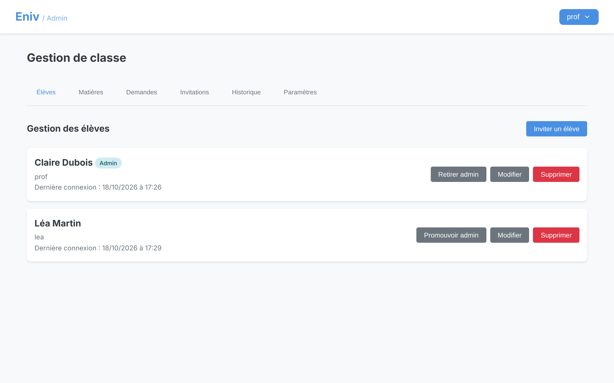<br><br>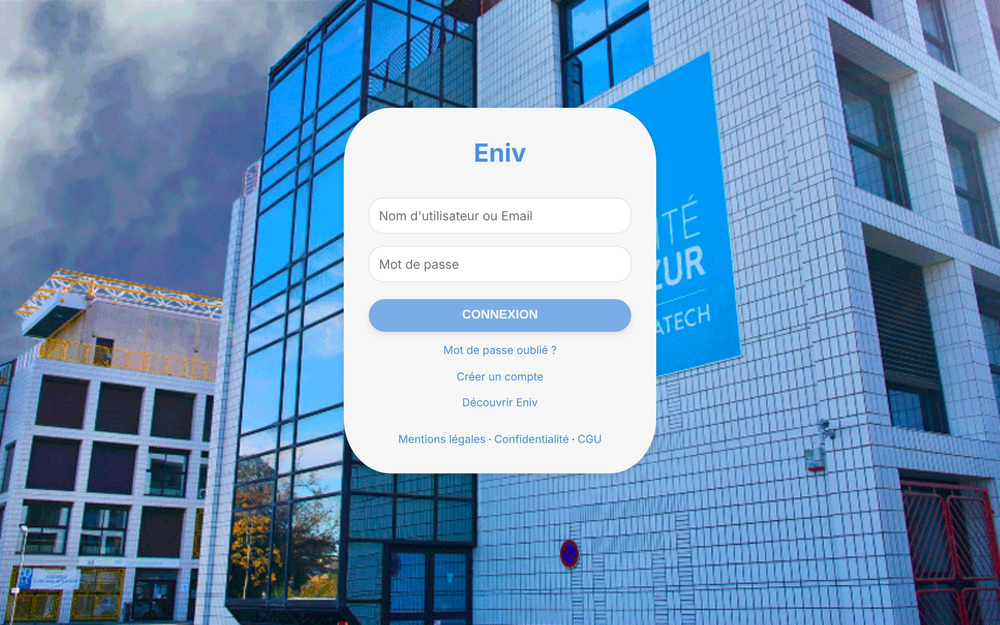</td>
</tr>
</table>

<details>
<summary><b>🧪 En cours de revue : notifications push, agenda, progression, commentaires…</b></summary>
<br>

| Fonctionnalité | Aperçu |
|---|---|
| 🔔 **Notifications push** : nouveau devoir, modification, rappel la veille à 18 h | 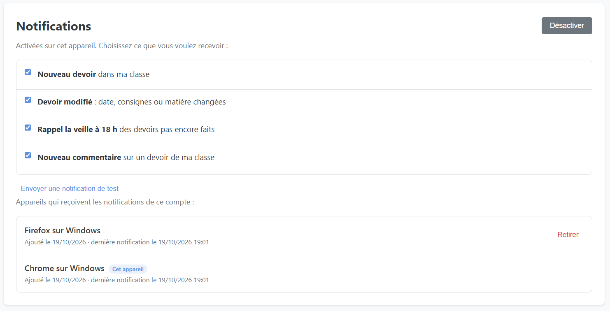 |
| 📅 **Abonnement agenda** (Google Agenda, Calendrier, Outlook) | 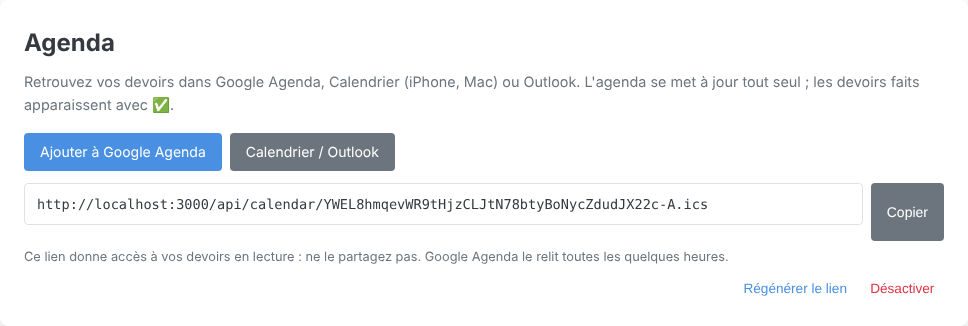 |
| 📊 **Ma progression** : taux de devoirs faits, série, devoirs à rattraper, semaine à venir | 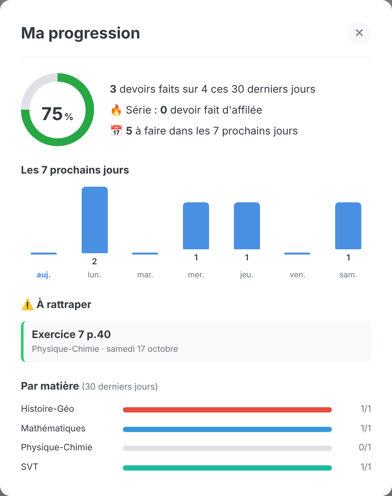 |
| 💬 **Commentaires sous un devoir**, en temps réel | 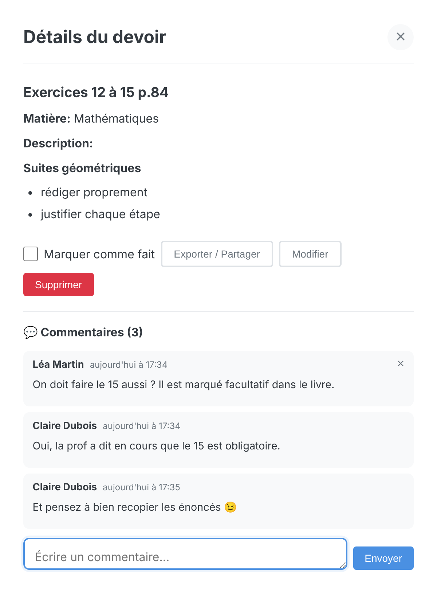 |

</details>

## 🏗 Architecture

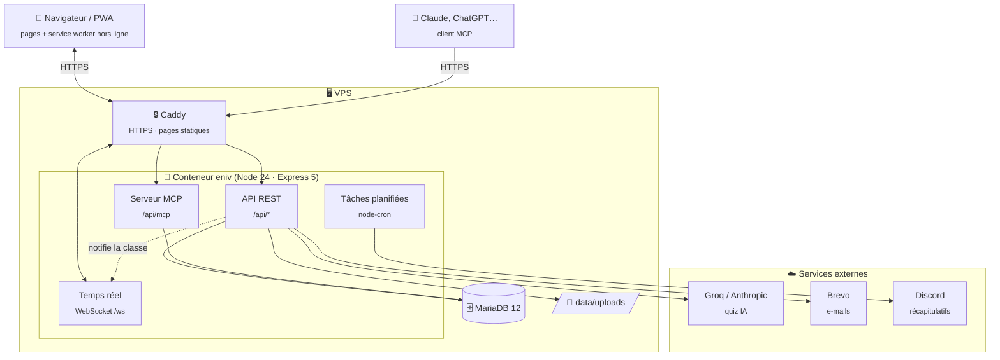

**Chemin d'une modification en temps réel** : un élève ajoute un devoir → `POST /api/devoirs` →
le middleware `realtimeNotifier` diffuse un événement **à la seule classe concernée** →
les autres onglets ouverts rechargent uniquement ce qui a changé.

<details>
<summary><b>📁 Structure du projet</b></summary>

```text
ENIV/
├── server.js                  # Point d'entrée Express + WebSocket
├── backend/
│   ├── middleware/            # Authentification JWT, notifications temps réel
│   ├── migrations/            # Migrations MySQL numérotées, jouées au démarrage
│   ├── models/                # Pool MySQL et utilitaire de requêtes
│   ├── routes/                # API REST (auth, devoirs, admin, quiz, mcp…)
│   └── services/              # E-mails, Discord, quiz IA, temps réel, MCP, PDF…
├── public/                    # Application (servie par Caddy en production)
│   ├── js/pages/              # Une page = un module
│   ├── js/utils/              # API, DOM, Markdown, temps réel
│   └── sw.js                  # Service worker (PWA, hors ligne)
├── public-site/               # Site vitrine eniv.fr et pages légales
├── docs/                      # Documentation et images du README
├── Dockerfile · compose.yml   # Image et déploiement de production
├── compose.yaml               # Environnement de développement (MySQL + phpMyAdmin)
└── deploy.sh                  # Mise à jour sur le VPS (lancé par GitHub Actions)
```

</details>

## 🚀 Installation

### Avec Docker (recommandé)

```bash
git clone https://github.com/ENIV-ENT/ENIV.git && cd ENIV
docker compose up
```

| Service | Adresse |
|---|---|
| Application | http://localhost:3000 |
| phpMyAdmin | http://localhost:8080 |

`compose.yaml` démarre MySQL, installe les dépendances et lance l'application, avec des valeurs de développement par défaut.

### Sans Docker

Prérequis : **Node.js 24** et **MySQL 8** ou **MariaDB 10.11+** (les deux sont compatibles ; la production tourne sur MariaDB 12).

```bash
cp .env.example .env      # puis renseigner DB_* et JWT_SECRET
npm install
npm run dev               # http://localhost:3000, rechargement automatique
```

Au premier démarrage, les tables et les migrations sont créées automatiquement,
ainsi que le compte **`superadmin`**, dont le mot de passe est **affiché dans les journaux**.
Changez-le dès la première connexion.

### Variables d'environnement

| Variable | Obligatoire | Rôle |
|---|:---:|---|
| `JWT_SECRET` | ✅ | Signature des jetons de connexion (`openssl rand -hex 48`) |
| `DB_HOST` `DB_PORT` `DB_NAME` `DB_USER` `DB_PASSWORD` | ✅ | Connexion à la base (MySQL ou MariaDB) |
| `BASE_URL` | ✅ | Adresse publique (liens des e-mails et de Discord) |
| `BREVO_API_KEY` `BREVO_SENDER_EMAIL` `BREVO_SENDER_NAME` | — | E-mails (invitations, mot de passe oublié…) |
| `GROQ_API_KEY` | — | Quiz IA des classes standard |
| `PREMIUM_API_KEY` | — | Quiz IA des classes premium (Anthropic) |
| `SUPERADMIN_PASSWORD` | — | Mot de passe du compte `superadmin` créé au premier démarrage (sinon tiré au hasard et affiché dans les journaux) |
| `VAPID_PUBLIC_KEY` `VAPID_PRIVATE_KEY` `VAPID_SUBJECT` | — | Notifications push : générées automatiquement si absentes. Une fois fixées, ne plus les changer (tous les abonnements deviendraient invalides) |

Sans clé, la fonctionnalité correspondante est simplement désactivée.

## 🌍 Déploiement

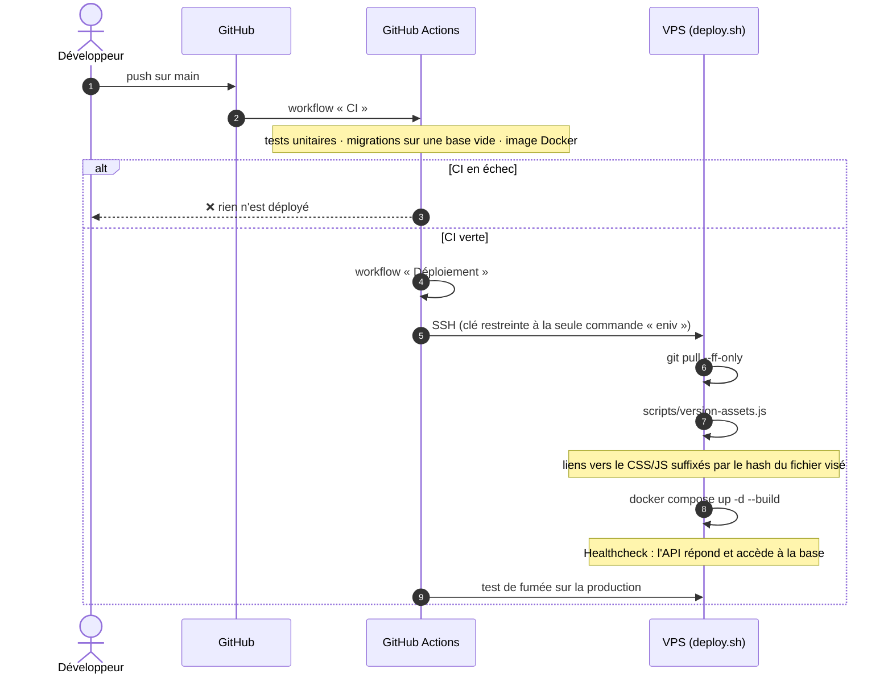

- **Image** : `Dockerfile` (Node 24, dépendances de production uniquement, utilisateur non root).
- **Production** : `compose.yml`, avec le port exposé sur `127.0.0.1` seulement. Caddy sert les pages statiques et relaie `/api`, `/ws` et `/vendor`. Les documents joints ne sont servis que par lien temporaire, réservé aux membres de la classe (`/api/fichiers/<jeton>`).
- **Versions des assets** : n'ajoutez pas de `?v=` à la main dans les liens vers le CSS et le JS. Au déploiement, `deploy.sh` les calcule à partir du contenu de chaque fichier (`scripts/version-assets.js`) : seuls les fichiers modifiés, et ceux qui les importent, sont rechargés par les navigateurs. Si vous avez lancé le script en local, `node scripts/version-assets.js --retirer` enlève les versions avant de committer.
- **Secrets GitHub** : `DEPLOY_SSH_KEY`, `DEPLOY_KNOWN_HOSTS`, `DEPLOY_HOST`.

## 👥 Contributeurs

<table>
  <tr>
    <td align="center" width="25%">
      <a href="https://github.com/Picsou06">
        <br>
        <b>Picsou06</b>
      </a><br>
      <sub>🚀 Créateur du projet</sub>
    </td>
    <td align="center" width="25%">
      <a href="https://github.com/Kevin-OVI">
        <br>
        <b>Kevin-OVI</b>
      </a><br>
      <sub>💻 Contributeur</sub>
    </td>
    <td align="center" width="25%">
      <a href="https://github.com/Tiretinium">
        <br>
        <b>Tiretinium</b>
      </a><br>
      <sub>💻 Contributeur</sub>
    </td>
    <td align="center" width="25%">
      <a href="https://github.com/CodeByHaamza">
        <br>
        <b>CodeByHaamza</b>
      </a><br>
      <sub>💻 Contributeur</sub>
    </td>
  </tr>
</table>

<p align="center"><sub>Détail des contributions : <a href="https://github.com/ENIV-ENT/ENIV/graphs/contributors">onglet Insights › Contributors</a></sub></p>

## 🤝 Contribuer

1. Créez une branche nommée selon le sujet : `feature/…`, `fix/…`, `securite/…`, `docs/…`, `ci/…`
2. Faites des commits **petits et séparés**, au format [Conventional Commits](https://www.conventionalcommits.org/fr/) :

   ```text
   feat(devoirs): pièces jointes par glisser-déposer
   fix(auth): 400 quand le mot de passe est absent
   docs(readme): schéma d'architecture
   ```

   | Type | Usage |
   |---|---|
   | `feat` | nouvelle fonctionnalité |
   | `fix` | correction de bug |
   | `refactor` | réorganisation sans changement de comportement |
   | `test` | ajout ou correction de tests |
   | `docs` | documentation |
   | `ci` / `chore` | outillage, CI, dépendances |

3. Ouvrez une pull request qui explique le **pourquoi**, l'**avant / après** et **comment c'est testé**.

<div align="center">
<br>
<sub>Fait avec ❤️ pour les élèves qui oublient leurs devoirs.</sub>
</div>
